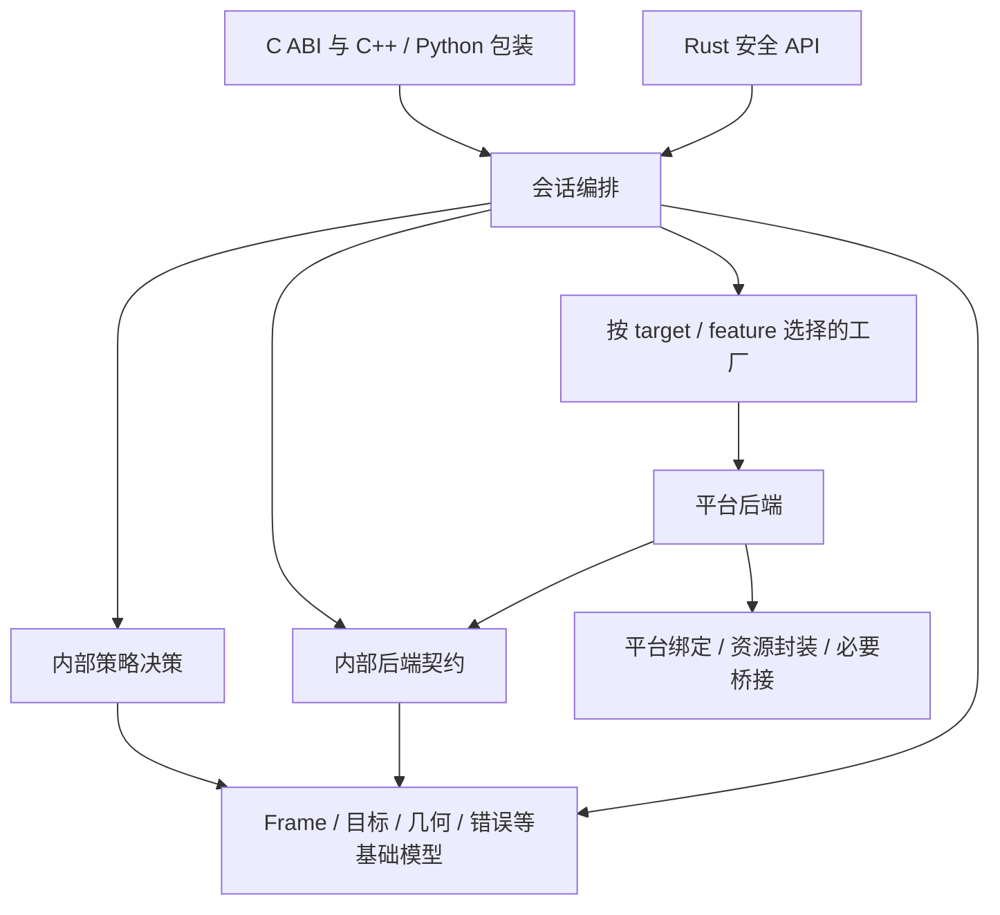
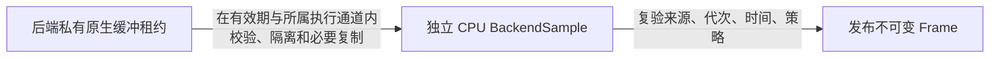

# 架构与项目结构

日期：2026-10-27。状态：设计约束已确认，产品实现与验收待完成；具体公共 SDK 类型、签名、状态编码与生成工具仍在 P2 验收后的 P3 定案。

阶段边界和验收门禁以[实施计划](../plans/maafw-screencap-extraction-plan.md)为准。本文未标明文件的“第 N 节”均指该计划的对应章节；计划保留原章节号并链接详细规则。U/P 继续保持固定上游行为，本文产品设计不提前进入 P0/P1/P2。

## 模块与依赖方向

采用一个捕获 crate 加独立 xtask；平台后端保持内部模块。单 crate 内也需通过私有模块、窄接口和代码审查维持依赖方向，不以目录名称作为隔离已经成立的证明。



图中箭头表示实现依赖；样本返回的数据流不代表后端可以反向调用 Session。Rust 安全入口直接复用会话实现，基础模型不依赖 C ABI、会话编排、具体后端或图像框架。内部后端契约不引用 Session、候选排序或缓存管理器；后端工厂只负责构造。

| 边界 | 所有的状态与职责 | 协作方式 |
| --- | --- | --- |
| frame / target / error | 不可变描述、像素所有者、布局与几何校验、结构化错误 | 可复用的基础类型和受检操作 |
| capture | Session 生命周期、操作事务、活动后端、缓存与 pending、最终发布检查 | 独占可变会话状态，按决策调用后端 |
| capture 内的 policy | 候选排序、回放条件、新鲜度、重试与容量规则 | 返回允许、拒绝、等待或重建等决策，不直接修改原生资源 |
| backend 契约 | 请求描述、独立 CPU 样本候选、原生结果与能力证据 | 不暴露原生映射租约；具体 trait/enum 在 P3 定案 |
| `backends/<platform>` | 原生对象、设备/连接/格式观察、事件和资源归还 | 遵守执行通道约束，返回样本与状态证据 |
| Windows coordinator | 窗口修改、共享租约、激活观察与恢复 | 同一已加载模块内共享；会话通过平台私有租约使用 |
| Runtime | 库实例配置、能力和必要共享服务的入口 | 不默认成为统一执行器或所有原生资源的拥有者 |

各状态的修改者应唯一明确。会话代次由会话编排推进；设备与原生会话失效证据由后端产生；格式、来源与窗口租约代次按各自事件更新，再由发布检查比较。内部使用区分种类的代次/身份类型，避免将不同计数器或快照指纹互换。

共享窗口注册表及 Win32 恢复实现在 Windows 后端内；跨平台会话只保存所需的目标/几何证据与租约状态。通用 support 模块仅在出现实际复用后引入，日志、算术、清理不集中成无边界工具集合。

## 核心对象

| 对象 | 职责和所有权 |
| --- | --- |
| Runtime | 库实例内的共享协调、后端能力和日志配置 |
| CaptureTarget | 带类型、创建后不可变的窗口、显示器、全虚拟桌面、PipeWire、Wlr/ExtImage 或 custom 目标；全虚拟桌面及 ExtImage 为 P3 产品扩展 |
| CaptureOptions | 方法范围、选择模式及不可变策略 |
| Session | 一个宿主串行调用的捕获会话 |
| BackendSample | 后端交出的独立 CPU 样本候选，带同次取样的来源、格式、样本身份和时间证据；失败通过显式结果报告 |
| Frame | 独立拥有目标范围内的原格式 CPU 像素及同次取样的格式、布局和来源元数据 |
| Operation / Cancellation | 单次操作的绝对期限、操作代次与可独立持有的取消信号 |
| MonitorSnapshot | 不可变显示器枚举快照；索引仅表示本次快照位置 |

Session 保留其所需的 Runtime 共享状态；释放宿主 Runtime 句柄后，已有 Session/Frame 的有效性与终结顺序明确规定。
日志 context、分配器及共享窗口协调状态分别按实际使用者保活，不能随 Runtime 外层句柄提前释放。
内部原生执行通道、通知与回调状态遵循同样的依赖寿命；具体初始化、配置和销毁契约在 P3 定义，不要求应用把 Rust 执行器或标准库对象传入 C ABI。

窗口身份记录原生 ID、拥有进程/线程和可取得的生命周期证据。
显示器目标使用来源 key，并报告其持久、会话或歧义范围；重复或歧义身份明确拒绝。
Linux provider 目标按授权会话和节点/输出语义表达，不宣称未经证明的持久显示器身份。
桌面坐标、内容矩形、像素尺寸、缩放和旋转分别表示，并附有效字段和限制标记。

全虚拟桌面的来源范围与重建规则见[来源契约](../contracts/lifecycle.md#全虚拟桌面目标)。Windows 的独立 GDI 方式使用屏幕 DC 一次取图，具体流程见[GDI 全虚拟桌面设计](gdi-virtual-desktop.md)，不要求逐屏捕获合成或窗口 helper。

P3 原生入口迁移遵循[现代化清单](native-interface-modernization.md)，沿同一实现替换平台封装，不建立 U/P/E 双后端。ExtImage 与 Wlr 按真实协议能力区分；PipeWire 来源描述能够保留已解析 serial 及其授权证明，不以可复用 node ID 表示持久身份，具体 SDK 形状在 P3 定案。

## 原生缓冲到 Frame 的交接



原生 Map/Lock、PipeWire buffer、Wayland 映射及 provider 接管状态各自留在所属封装内。共享的布局/逐行复制函数可由后端调用；算法由核心提供不意味着原生释放责任转移给核心。

后端交接点保证 CPU 存储不依赖后续 Unmap/Unlock、归还 producer 或 Session 临时对象。无法证明独立寿命的样本不得进入通用后端契约。原生内存不能仅凭 Send 标记跨线程交接。

会话完成最终发布检查后优先转移或不可变共享同一 CPU 存储，不为包装 Frame 再做一次完整复制；失败候选通过正常所有权路径释放。帧配额记账随存储存活，独立于 Runtime/Session 外层句柄，缓存只引用不可变存储。减少复制的具体实现仍须测量并保持范围隔离。

U/P 的内部交接不冻结此产品接口。需要兑现原转换调用时点时，继续在该点接入私有验收适配，不因采用本图而移动转换、改变缓冲归还或缓存语义。

## 目标项目结构

以下是随阶段建立的目标结构。当前实际仍为 `src/main.rs` 的 Hello World；不预建空后端、桥接、测试或示例，不把目录存在当作实现完成。

```text
maafw-screencap/
  LICENSE
  README.md
  THIRD_PARTY_NOTICES
  licenses/GPL-3.0.txt
  Cargo.toml                       # 一个捕获 library package + xtask workspace
  rust-toolchain.toml
  build.rs                         # 按 TARGET 复验、生成和必要编译
  build-support/                   # 构建逻辑及维护的原生/ABI 生成输入
  include/maafw-screencap/          # 公共 C 契约与 C++ RAII 包装
  src/
    lib.rs                         # Rust 安全 API
    c_api/                         # 对外 C ABI、句柄、参数/错误映射
    capture/                       # 会话、操作事务、策略、缓存、发布检查
    frame/                         # 独立存储、格式、布局、隔离与复制
    target/                        # 来源身份、几何和布局依赖描述
    backend.rs                     # 仅依赖基础模型的内部后端契约
    runtime.rs                     # 库实例配置与共享服务入口
    error.rs
    allocation.rs                  # nightly fallible API 内部窄封装
    backends/
      windows/                     # 原生绑定/资源封装、窗口协调均在此
      linux/                       # PipeWire / Wlr 及局部原生封装
      macos/                       # ScreenCaptureKit 及局部原生封装
  native/<platform>/               # 仅在证明绑定缺口后添加窄桥接
  bindings/                        # 基础绑定及语言薄适配
  tests/
    contracts/main.rs              # 对应 cargo test --test contracts
    common/mod.rs
    fixtures/                      # 自有确定性输入，非外部参考副本
    image-contracts/               # 跨语言入口，由 xtask 显式编排
    upstream-parity/               # 私有对照入口与 C++ 验收适配
    desktop/                       # 显式桌面任务与串行夹具
    consumer/                      # 独立 SDK / binding 消费工程
  examples/                        # 随可用 API 提供原格式和图像适配示例
  benches/
  xtask/                           # 准备、对照、打包、消费验证
  cmake/                           # SDK imported target 模板
  scripts/                         # 必要的薄启动入口
  docs/
    README.md
    plans/
    decisions/
    design/
    contracts/
    guides/
```

原生声明及其安全封装靠近对应平台资源，不设混合所有平台的 `src/ffi/`。`src/c_api/` 只表示向外导出的边界。Rust 图像适配按已确认路线放在 binding 侧独立包或调用端源码，不进入捕获 crate 依赖树。

模块、运行依赖及原生构建分别按目标平台隔离。编译期开关与运行时选择分离；具体规则见[开发与验证指南](../guides/development.md)。生成声明与手写所有权封装分开维护，输入布局见[C ABI 设计](../contracts/c-abi.md)。

模块使用 `#[cfg(target_os = "...")]` 联合后端 feature，平台运行依赖放入对应 Cargo target 表，原生步骤根据 `CARGO_CFG_TARGET_OS`、`TARGET` 执行。其他平台后端不进入当前产品编译与链接；源码包仍保留全部平台源文件，跨平台依赖解析记录不代表它们进入本次产物。

## 阶段内演进

P0/P1 只建立实现迁移所需的窄边界、构建及测试入口，不提前实现最终产品状态机。P2 只应用固定补丁。P3 沿同一代码主线增量落实本设计，U/P 通过外部不可覆盖快照重建，不在产品长期维护 legacy/product 双份后端，也不用 feature 切换 U/P/E 整套行为。

各代次和状态转换记录触发事件、拥有者、缓存影响、清理责任及下一次允许的操作；逻辑状态、原生资源状态和待恢复责任分别表示，避免一个 connected 布尔值或覆盖所有组合的巨型枚举。
